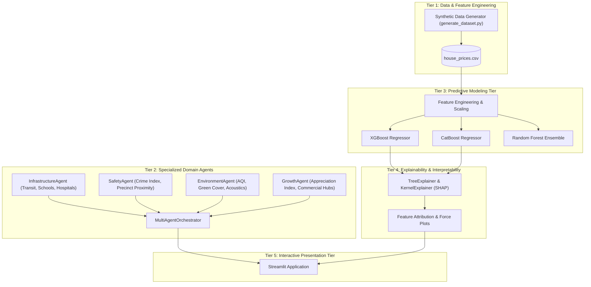

# Multi-Agent Explainable House Price Prediction System

An end-to-end, multi-agent AI framework for residential real estate valuation that blends traditional structural property attributes with localized societal intelligence (civic infrastructure, public safety, environmental sustainability, and economic growth potential).

The system integrates gradient boosting regression models (XGBoost, CatBoost) with SHAP (SHapley Additive exPlanations) and domain-specific autonomous agent evaluations to produce transparent, auditable, and human-interpretable pricing rationales.

---

## 🏛 System Architecture & Component Tiers



### Component Tiers Overview

1. **Tier 1 — Data & Feature Engineering Tier (`data/`)**:
   - Synthesizes and prepares realistic real estate records.
   - Combines structural parameters (`sqft`, `bhk`, `bathrooms`, `property_age`, `floor_number`, `parking_spaces`) with localized societal indicators (`school_score`, `crime_rate`, `aqi`, `growth_index`, `transit_score`, `police_proximity_km`, `green_cover_pct`, etc.).

2. **Tier 2 — Domain-Specific Multi-Agent Tier (`agents/`)**:
   - `InfrastructureAgent`: Evaluates civic amenities, school performance, and mass transit connectivity.
   - `SafetyAgent`: Quantifies neighborhood crime risks and emergency service proximity.
   - `EnvironmentAgent`: Analyzes air quality (AQI), acoustic noise levels, and canopy/green cover.
   - `GrowthAgent`: Evaluates commercial velocity, infrastructure expansion, and capital appreciation potential.
   - `MultiAgentOrchestrator`: Aggregates dimension scores into composite indexes and localized multipliers.

3. **Tier 3 — Predictive Modeling & Ensemble Tier (`models/`)**:
   - High-performance gradient boosted decision trees (XGBoost, CatBoost) and baseline regressors (Scikit-learn) trained on fused structural-societal features.

4. **Tier 4 — Explainability & Interpretability Tier**:
   - Leverages **SHAP** values to break down individual price predictions into additive dollar-value contributions per feature.
   - Merges quantitative SHAP attributions with qualitative qualitative agent insights.

5. **Tier 5 — Interactive Presentation Tier (`app.py`)**:
   - Responsive Streamlit dashboard displaying predicted property values, agent radar/spider charts, SHAP breakdown plots, and contextual buyer/investor summaries.

---

## 📁 Project Directory Structure

```text
HP_Prediction/
├── requirements.txt         # Core dependencies (Streamlit, XGBoost, CatBoost, SHAP, etc.)
├── README.md                # Project documentation and setup guide
├── data/
│   └── generate_dataset.py  # Synthetic real estate data generation script
└── agents/
    ├── __init__.py          # Exports agent classes and orchestrator
    └── agents.py            # BaseAgent, Infrastructure, Safety, Environment, Growth agents
```

---

## 🚀 Setup & Installation Instructions

### 1. Prerequisites
- Python 3.9+ (Python 3.10 or 3.11 recommended)
- `pip` package manager

### 2. Clone or Navigate to Project Directory
```bash
cd c:\Users\srian\HP_Prediction
```

### 3. Create and Activate Virtual Environment
```bash
# Windows (PowerShell)
python -m venv venv
.\venv\Scripts\Activate.ps1

# Linux / macOS
python -m venv venv
source venv/bin/activate
```

### 4. Install Dependencies
```bash
pip install -r requirements.txt
```

### 5. Generate the Dataset
Run the data generator to create a synthetic dataset of 5,000 real estate properties:
```bash
python data/generate_dataset.py --samples 5000 --output data/house_prices.csv
```

### 6. Verify Agent Pipeline
You can test the agent scoring framework in Python:
```python
from agents import MultiAgentOrchestrator

sample_property = {
    "sqft": 1450,
    "bhk": 3,
    "bathrooms": 2,
    "property_age": 4,
    "school_score": 8.5,
    "transit_score": 7.8,
    "hospital_distance_km": 1.8,
    "crime_rate": 22.0,
    "police_proximity_km": 1.5,
    "aqi": 52,
    "green_cover_pct": 38.0,
    "noise_level_db": 48.0,
    "growth_index": 82.0,
    "commercial_hub_distance_km": 3.2,
}

orchestrator = MultiAgentOrchestrator()
report = orchestrator.evaluate_property(sample_property)
print("Composite Score:", report["composite_score"])
print("Radar Metrics:", report["radar_metrics"])
for insight in report["all_insights"]:
    print("-", insight)
```

---

## 🔮 Next Steps
- Implement model training pipeline (`models/train.py`) utilizing XGBoost & CatBoost with cross-validation.
- Build explainability engine (`explainability/shap_explainer.py`).
- Launch interactive Streamlit dashboard (`app.py`).
